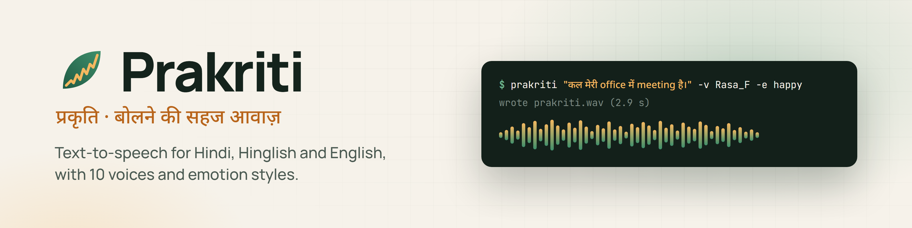
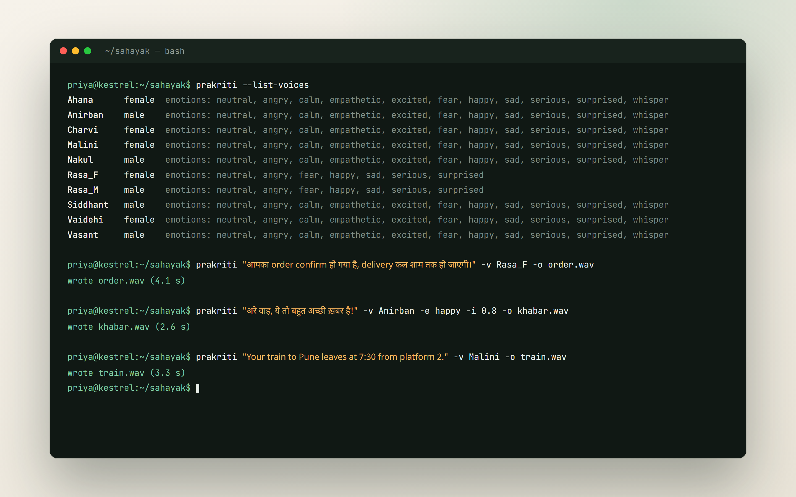

<picture>
  <source media="(prefers-color-scheme: dark)" srcset="assets/banner-dark.png">
  
</picture>

Prakriti turns Hindi, Hinglish and English text into speech with 10 voices and per-voice emotion styles.
The model has 82M parameters: it runs about 2.6x faster than real time on 4 CPU threads and about 36x on a GPU.

[](LICENSE)
[](https://github.com/anand34577/prakriti/actions/workflows/ci.yml)
[](https://huggingface.co/anand-k-maurya/prakriti-v1)



## Why

Most open TTS models either skip Hindi or read it like a foreign language: wrong schwa deletion
(कमला as "kamala"), ड़ said as "r", numbers read digit by digit. Indian speech also mixes languages
mid-sentence ("कल मेरी office में meeting है"). Prakriti was built for that mix, small enough to run on
a voice-assistant box, and trained only on data that allows an Apache-2.0 release.

## Features

- Reads Hindi in Devanagari, Hinglish with English words in Latin script, and Indian English
- 10 voices, including 2 trained on real studio recordings (`Rasa_F`, `Rasa_M`)
- Emotion styles per voice (happy, sad, angry, fear, surprised, calm, serious and more), with an intensity knob from 0 to 1
- Says numbers the Indian way: ₹1,50,000 becomes "एक लाख पचास हज़ार रुपये", 5:30 becomes "साढ़े पाँच"
- Spells out acronyms (SBI, OTP) but keeps ISRO and NASA as words
- Streams sentence by sentence, so a voice assistant can start talking before the whole reply is synthesized
- Ships a pronunciation lexicon of 4,864 words checked against recorded speech
- Each voice is pitch-calibrated to its own recordings

## Quick start

You need Python 3.10 to 3.12 and espeak-ng.

```bash
# Ubuntu / Debian
sudo apt install espeak-ng
# Windows: install espeak-ng from https://github.com/espeak-ng/espeak-ng/releases

pip install "git+https://github.com/anand34577/prakriti.git"
prakriti "नमस्ते! आपका order कल तक पहुँच जाएगा।" -v Rasa_F -o hello.wav
```

The first run downloads the model (about 360 MB) from Hugging Face and caches it.

## Usage

```python
from prakriti.tts import Prakriti
import soundfile as sf

tts = Prakriti.from_pretrained()   # or a local folder, or another Hugging Face repo id
audio = tts.synthesize(
    "अरे वाह, ये तो बहुत अच्छी ख़बर है!",
    voice="Rasa_F", emotion="happy", intensity=0.8,
)
sf.write("news.wav", audio, 24000)
```

For a voice assistant, play each sentence as soon as it's ready:

```python
for chunk in tts.stream(reply_text, voice="Anirban"):
    speaker.write(chunk)    # 24 kHz mono float32
```

List the voices and the emotions each one has:

```bash
prakriti --list-voices
```

## Command-line options

| Option | Default | What it does |
|---|---|---|
| `-v`, `--voice` | `Rasa_F` | Voice name, see `--list-voices` |
| `-e`, `--emotion` | `neutral` | Emotion style; falls back to neutral if the voice doesn't have it |
| `-i`, `--intensity` | `1.0` | 0 = neutral, 1 = full emotion |
| `-s`, `--speed` | `1.0` | Speaking rate; 0.9 is a little slower |
| `-p`, `--pitch` | `1.0` | Pitch multiplier on top of the voice's calibrated pitch |
| `-o`, `--output` | `prakriti.wav` | Output WAV file |
| `-m`, `--model` | `anand-k-maurya/prakriti-v1` | Local model folder or Hugging Face repo id (also `PRAKRITI_MODEL`) |
| `--device` | auto | `cuda` or `cpu` |

## Voices

| Voice | Gender | Trained from |
|---|---|---|
| `Rasa_F`, `Rasa_M` | female, male | Real studio speech (Rasa dataset) |
| `Ahana`, `Vaidehi`, `Malini`, `Charvi` | female | Speech generated with Maya 2 Native |
| `Anirban`, `Nakul`, `Vasant`, `Siddhant` | male | Speech generated with Maya 2 Native |

The two Rasa voices sound the most natural. The other eight cover more emotions.

## Results

Same 65 test sentences for every system (Prakriti and Maya: all voices; Kokoro: its 4 Hindi and 4 English voices).

| System | Hindi error | Hinglish error | English error | Naturalness (UTMOS) | Size |
|---|---|---|---|---|---|
| **Prakriti v1** | 2.7% | 14.1% | 0.0% | 3.75 (Hindi), 4.11 (English) | 82M |
| Kokoro-82M (stock) | 2.6% | 11.3% | 0.0% | 4.26 (Hindi), 4.38 (English) | 82M |
| Maya 2 Native (teacher) | 3.1% | 11.0% | 0.9% | 3.45 (Hindi), 3.75 (English) | 2.5B |

The two studio voices score highest on naturalness: `Rasa_F` 4.15 and `Rasa_M` 4.12 on Hindi and Hinglish sentences (8.3% combined error for both), against 3.63 to 3.93 for the other eight.

| Device | Faster than real time | Median time per sentence |
|---|---|---|
| GPU (RTX A6000) | 36.6x | 0.11 s |
| CPU, 4 threads | 2.6x | 1.6 s |
| CPU, 2 threads | 1.6x | 2.5 s |

Error is Whisper large-v3's character error rate after script-neutral transliteration (Hindi, Hinglish) or word
error rate (English); lower is better, and Hinglish numbers include transliteration noise for every system.
Naturalness is UTMOS, an English-trained automatic predictor: use it to compare systems, not as an absolute score.
After pitch calibration every voice speaks within a few Hz of its own training recordings, with no change in
error or naturalness.

## Train it yourself

The full pipeline that produced the model is in this repo: text generation, synthesis, Whisper and
emotion checks, audio-verified pronunciation labels, and two-stage fine-tuning. It runs unattended on one
48 GB GPU under systemd and survives SSH drops, crashes and reboots. The
[wiki](https://github.com/anand34577/prakriti/wiki) walks through it step by step:
[Training](https://github.com/anand34577/prakriti/wiki/Training).

## Limitations

- Emotion is moderate. Sad and surprised come through; anger, fear and excitement are subtle.
- `[laugh]` and other non-verbal tags are weak.
- Romanized Hinglish ("kya haal hai") is read with English rules. Write Hindi words in Devanagari.
- Rockchip NPU export isn't done yet. On RK3588 / RK3576 it runs on the CPU cores.

## Contributing

Bug reports with the exact sentence that sounds wrong help the most. See [CONTRIBUTING.md](CONTRIBUTING.md).

## License

Apache-2.0. Prakriti is a fine-tune of [Kokoro-82M](https://huggingface.co/hexgrad/Kokoro-82M) and was
trained on [Rasa](https://huggingface.co/datasets/ai4bharat/Rasa) (CC-BY-4.0, AI4Bharat) and speech
generated with Maya 2 Native. Full attributions are in [NOTICE](NOTICE).
