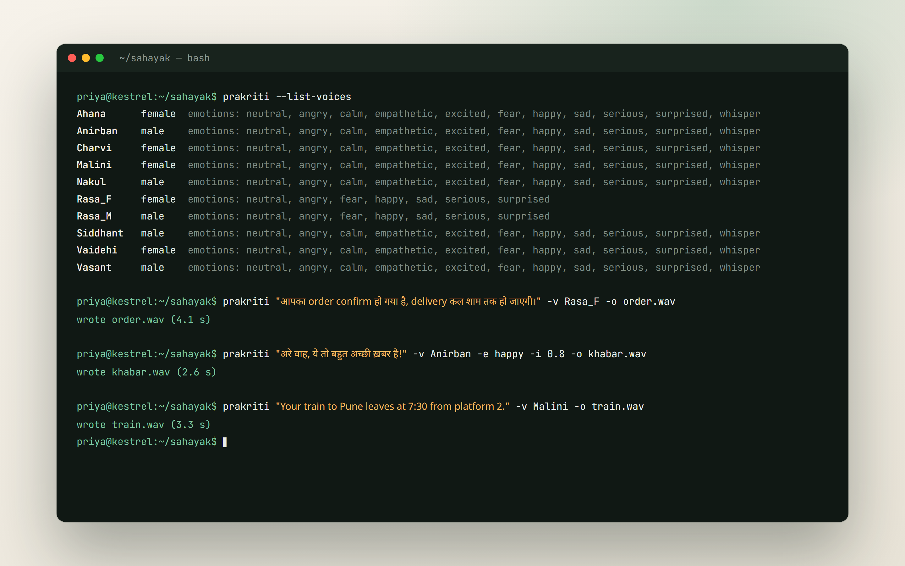

# Prakriti

Prakriti is a text-to-speech model and toolkit for Hindi, Hinglish (Hindi mixed with English) and Indian
English. You give it text, it gives you a WAV file or a stream of audio, in one of 10 voices and with an
emotion style if you want one.

It's meant for voice assistants, IVR and announcement systems, audiobooks and accessibility tools, and it's
small enough (82M parameters) to run on a normal CPU.

## Start here

1. [Installation](Installation): Python, espeak-ng and the package
2. [Getting Started](Getting-Started): your first audio file in about ten minutes
3. [Configuration](Configuration): voices, emotions, speed, pitch and every option
4. [Usage](Usage): the Python API, streaming for assistants, fixing a pronunciation

## Going further

- [Deployment](Deployment): running it as a service, on CPU-only machines, and on Rockchip RK3588 / RK3576 boards
- [Training](Training): how the model was trained and how to train your own voices
- [Architecture](Architecture): how the pieces fit together
- [Troubleshooting](Troubleshooting) and [FAQ](FAQ)
- [Changelog](Changelog)
