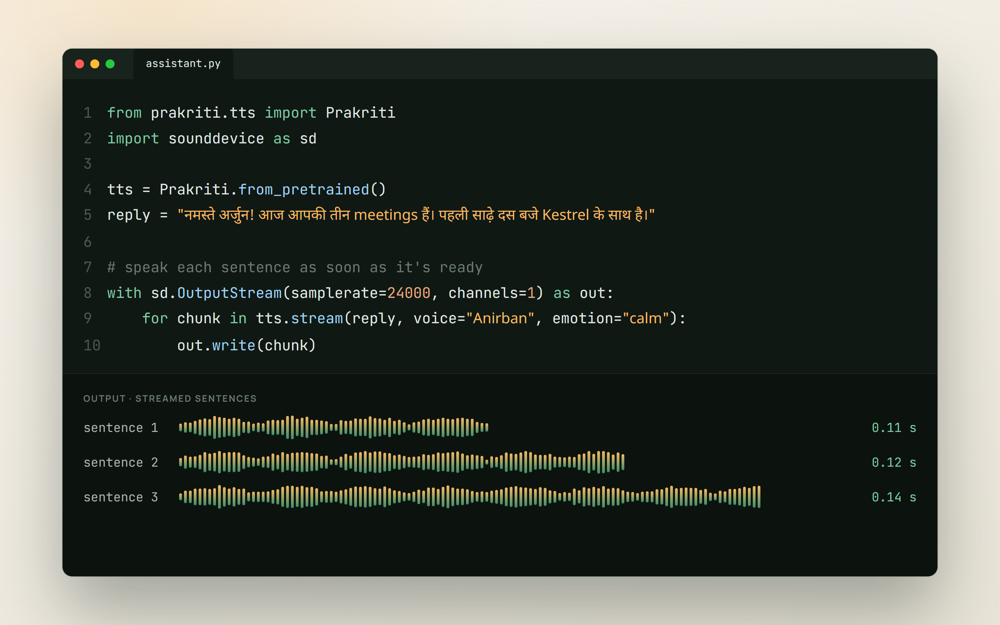

# Usage

Task-by-task examples. Settings are explained in [Configuration](Configuration).

## Make a WAV file

```python
from prakriti.tts import Prakriti
import soundfile as sf

tts = Prakriti.from_pretrained()
audio = tts.synthesize("नमस्ते! आपका स्वागत है।", voice="Rasa_F")
sf.write("welcome.wav", audio, 24000)
```

Load the model once and reuse the `tts` object. Loading takes a few seconds; each sentence after that takes
about 0.1 s on a GPU and about 1.5 s on 4 CPU threads.

## Speak while generating (voice assistants)

`stream()` splits the text into sentences and yields each one as soon as it's ready, so the first sentence
plays while the rest are still being made.

```python
import sounddevice as sd    # pip install sounddevice

with sd.OutputStream(samplerate=24000, channels=1) as out:
    for chunk in tts.stream(reply_text, voice="Anirban", emotion="calm"):
        out.write(chunk)
```

Keep the first sentence of a reply short; that's what decides how long the user waits.



## Pick an emotion per line

```python
lines = [
    ("आपका payment सफल रहा।", "happy"),
    ("माफ़ कीजिए, ये सेवा अभी उपलब्ध नहीं है।", "empathetic"),
]
for text, emo in lines:
    audio = tts.synthesize(text, voice="Malini", emotion=emo, intensity=0.7)
```

`tts.emotions("Malini")` lists what that voice supports.

## Read text from a file

```bash
prakriti - -v Rasa_M -o chapter1.wav < chapter1.txt
```

Long text is split into sentences automatically. Very long sentences are split at commas.

## Fix a word that sounds wrong

1. See what Prakriti produces for it:
   ```bash
   python -c "from prakriti.text.frontend import phonemize; print(phonemize('वाक्य'))"
   ```
2. Write the correct pronunciation in the same symbol set and add it to `lexicon.json` in your model folder
   (or `prakriti/text/lexicon.json` in the repo):
   ```json
   { "वाक्य": "ʋˈaːkjə" }
   ```
3. Run your sentence again.

If a whole pattern is wrong (for example, many words ending in the same cluster), please open an issue with a
few example words; it's probably a rule in `prakriti/text/hindi_g2p.py`.

## Use it offline

Download the model once:

```bash
python -c "from huggingface_hub import snapshot_download; print(snapshot_download('anand-k-maurya/prakriti-v1'))"
```

That prints a folder path. Pass it with `-m`, or set `PRAKRITI_MODEL` to it, and no network is needed.
